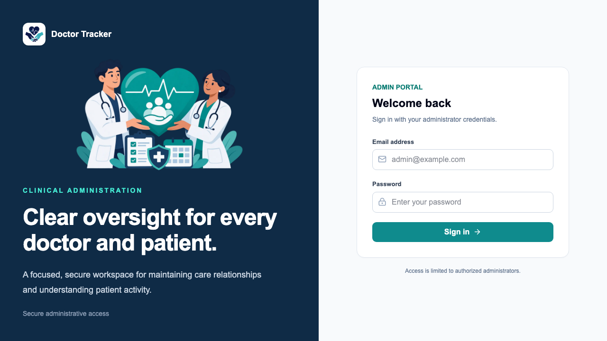
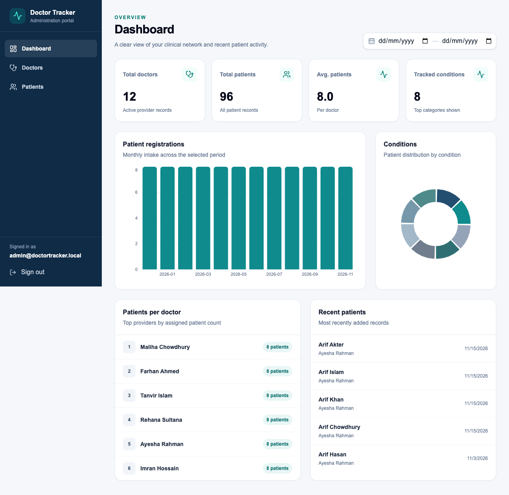

# Doctor Tracker

## Description

Doctor Tracker is a secure, responsive administration portal that gives healthcare teams one focused workspace for managing doctors, maintaining doctor–patient relationships, searching and filtering clinical directories, and reviewing operational trends through meaningful dashboard analytics. The product pairs a professional Next.js interface with a separate Express and MongoDB API, providing fast paginated workflows, protected access, and a clean experience across desktop and mobile devices.

## Setup Guide

### Prerequisites

- Node.js 24 LTS
- pnpm 10 or newer
- MongoDB 7 or a MongoDB Atlas deployment
- The separate `doctor-tracker-backend-assesment` repository

### 1. Configure and start the backend

```bash
cd doctor-tracker-backend-assesment
pnpm install
cp .env.example .env
```

Edit the backend `.env`, then initialize and run the API:

```bash
pnpm seed
pnpm dev
```

The API runs at `http://localhost:5001` by default. The seed command is idempotent: it upserts the configured administrator and demonstration records without deleting unrelated data.

### 2. Configure and start the frontend

```bash
cd doctor-tracker-assesment-frontend
pnpm install
cp .env.example .env.local
pnpm dev
```

Open [http://localhost:3000](http://localhost:3000) and sign in with the `ADMIN_EMAIL` and `ADMIN_PASSWORD` configured in the backend.

## Demo Credentials

Reviewers can access the [live Doctor Tracker application](https://doctor-tracker-assessment-frontend.vercel.app/) with the following assessment account:

```text
Email: admin@doctortracker.local
Password: DoctorTracker!2026#Admin
```

> These credentials are intentionally public for project evaluation only. Rotate or remove this account after the assessment.

### Environment variables

The committed [`.env.example`](./.env.example) is safe to copy:

```dotenv
API_SERVER_URL=http://localhost:5001
```

`API_SERVER_URL` is read by the Next.js server. Browser requests use the same-origin `/api/*` path, which Next.js proxies to Express so the authentication cookie is never exposed to client-side JavaScript.

### Available scripts

| Command | Purpose |
| --- | --- |
| `pnpm dev` | Start the Next.js development server |
| `pnpm build` | Create an optimized production build |
| `pnpm start` | Serve the production build |
| `pnpm lint` | Run ESLint |
| `pnpm typecheck` | Validate TypeScript without emitting files |
| `pnpm test` | Run Vitest component tests |
| `pnpm test:e2e` | Run Playwright desktop and mobile workflows |

## System Architecture

```text
┌─────────────────────────────────────────────────────────────────┐
│ Browser                                                         │
│ Next.js App Router UI · TanStack Query · URL-based list state   │
└──────────────────────────────┬──────────────────────────────────┘
                               │ same-origin /api/* requests
                               ▼
┌─────────────────────────────────────────────────────────────────┐
│ Next.js server                                                  │
│ Route protection · API proxy · server-side session validation   │
└──────────────────────────────┬──────────────────────────────────┘
                               │ REST + HTTP-only JWT cookie
                               ▼
┌─────────────────────────────────────────────────────────────────┐
│ Express API                                                     │
│ Helmet · rate limiting · Zod validation · authentication        │
│ REST controllers · centralized errors · production-safe logs    │
└──────────────────────────────┬──────────────────────────────────┘
                               │ indexed Mongoose queries
                               ▼
┌─────────────────────────────────────────────────────────────────┐
│ MongoDB: doctor_tracking                                       │
│ Admins · Doctors · Patients · aggregation-based analytics       │
└─────────────────────────────────────────────────────────────────┘
```

The browser never connects to MongoDB or Express directly. Next.js renders the interface and forwards API traffic to the standalone backend. Express remains the authorization boundary, validates every protected request, performs indexed database queries, and returns consistent JSON responses. TanStack Query caches those responses and invalidates only the affected records after a mutation.

## Technical Decisions

### 1. TanStack Query and URL state instead of Redux

Most shared state in Doctor Tracker is server-owned data: doctor lists, patient lists, filter options, and dashboard aggregates. TanStack Query is designed for this lifecycle and supplies request deduplication, caching, background refresh, mutation state, and targeted invalidation without a reducer/action layer. A successful patient edit, for example, invalidates the patient list and relevant dashboard queries while leaving unrelated UI state untouched.

Search terms, filters, page number, and page size are stored in URL search parameters rather than a global store. This makes every directory view refresh-safe, bookmarkable, and compatible with browser navigation. Local component state is reserved for temporary concerns such as dialog visibility and form input. Redux would add synchronization code and another source of truth without solving a state problem this application has.

### 2. Referenced patient documents instead of embedded patient arrays

Patients are stored as independent MongoDB documents with an indexed `doctor` reference. Embedding every patient inside a doctor document would make global patient search, patient-level updates, and condition/date filtering increasingly expensive as those arrays grow. It could also push popular doctor records toward MongoDB's document-size limit and cause unrelated patient edits to contend on the same parent document.

References keep doctor documents small and allow patient queries to use focused compound indexes such as doctor/date and condition/date. They also make pagination predictable and allow dashboard pipelines to group, count, and join only the fields they need. The trade-off is that doctor details occasionally require a join or second query, which is handled with bounded projections and MongoDB aggregation rather than loading full collections into application memory.

## Visual Evidence

### Login landing page

The secure login experience introduces the product with the updated Doctor Tracker identity and medical-care hero artwork.



### Authenticated dashboard

After authentication, the dashboard presents navigation, key metrics, date filtering, charts, provider distribution, and recent patient activity in one responsive workspace.



## Deployment

Deploy the frontend and backend as separate Node.js services. Configure `API_SERVER_URL` on the frontend and set `MONGODB_URI`, `MONGODB_DB_NAME`, `FRONTEND_ORIGIN`, `JWT_SECRET`, `COOKIE_SECURE=true`, and the administrator seed variables on the backend. Rotate all development credentials before deployment.

- Live project: [Doctor Tracker](https://doctor-tracker-assessment-frontend.vercel.app/)
- Frontend repository: [doctor-tracker-assessment-frontend](https://github.com/morsalin101/doctor-tracker-assessment-frontend)
- Backend repository: [doctor-tracker-assessment-backend](https://github.com/morsalin101/doctor-tracker-assessment-backend)

> Doctor Tracker is an assessment-grade administrative tracker, not a certified electronic medical-record or regulatory-compliance platform.
